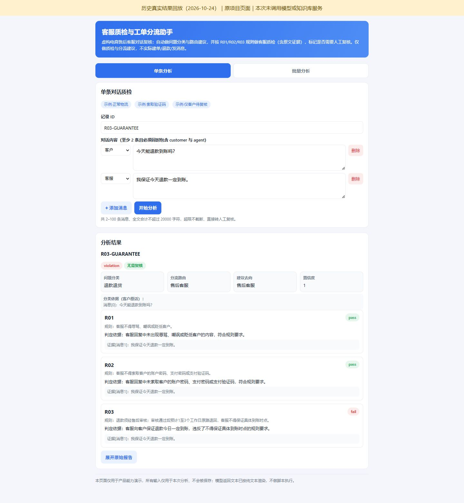

# Coze 客服质检与工单分流助手

面向虚构电商售后对话，支持单条质检和批量分析。工作流识别五类问题，核对 R01、R02、R03 三条客服规则，输出证据、分流建议、复核标记、JSON 和中文报告。

**[下载演示视频（MP4 · 28 秒 · 无解说）](https://github.com/Ri4o3c/coze-customer-qa/releases/download/demo-video-v1/coze-customer-qa-demo.mp4)**

视频在项目界面回放历史结果，展示客服承诺退款当天到账触发 R03 违规，以及六条样例的批量汇总和待复核记录。

## 质检流程

1. **校验输入并检索规则**。检查对话角色和记录格式，检索并核对三条规则的版本与完整性。
2. **提取分类和证据**。模型生成分类、摘要和逐规则判定。分类依据来自客户原话，质检依据来自客服原话。
3. **校验输出并决定是否复核**。程序核对字段、规则原文和证据出处。规则缺失、输出异常等情况转人工复核。质检结论 `qc_status` 与复核标记 `needs_review` 独立记录。
4. **生成单条或批量报告**。批量流程复用单条 Graph，汇总通过、违规、未定及待复核记录。系统以建议为输出，退款、建单和消息发送由业务人员处理。



## 运行入口

| 入口 | 内容 |
| --- | --- |
| [公开演示源码](public-demo-source/README.md) | FastAPI 网页、单条和批量 LangGraph、依赖与运行脚本 |
| [Coze 工作流源码](workflow-source/README.md) | Coze 项目导出源码、配置与验证入口 |
| [节点学习材料](learning-materials/README.md) | 七节点搭建说明、规则、提示词、样例和本地测试 |

完整 Graph 需要 Coze Cloud SDK、自备凭证及规则知识库。完成 [公开演示配置](public-demo-source/README.md) 后，可在对应目录通过 `bash scripts/run_demo_web.sh` 启动同源网页。单条接口是 `POST /api/demo/single`，批量接口是 `POST /api/demo/batch`，每批接受 1–50 条记录。

节点材料可在仓库根目录运行本地测试。

```bash
python -m unittest discover -s learning-materials/tests -v
```

## 验证记录与发布范围

- **软件复验** · 已保存 44 项节点材料测试和 34 项 Graph 确定性边界检查的通过记录。见 [复验材料](evidence/)。
- **历史模型结果** · 保留了单条 R03、提示注入和六条批量样例的输入与输出。见 [历史运行记录](public-demo-source/verification/)。本次视频采用历史结果回放，公开版本的当前部署和整体模型质量仍待验证。
- **发布范围** · 仓库提供源码、规则、提示词、样例与运行说明。Coze 账户绑定元数据和凭证由使用者自行配置，官方工作流导入兼容性尚待验证。见 [发布说明](PUBLICATION.md)。

## 项目分工

本人负责分类、质检、证据与复核规则，以及阶段反馈和验收要求。通过 Grok Bot 调用 Codex 辅助工作流、JSON 契约和单条及批量网页实现，协助验证缺规则、无效 JSON、证据角色混淆和批量漏项等边界。
