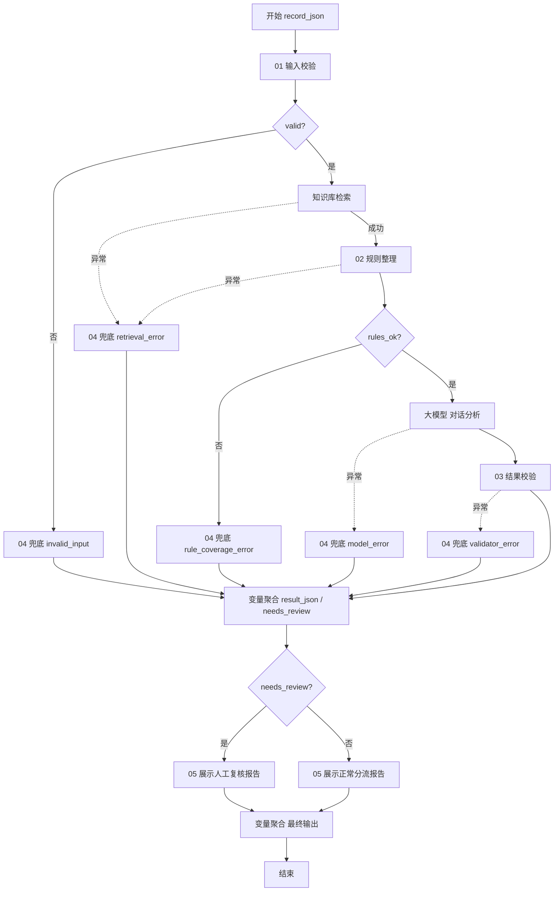

# 单条工作流：customer_qa_single_v1

## 资源准备

创建专用文本知识库 `customer_service_rules_v1`。只上传knowledge目录3份TXT，完成解析。每份文件尽量保持一个完整切片；如自动切块使RULE_ID与POLICY分离，调整切片后再发布。规则极短，建议在预览中检查每块都含ID、版本和POLICY。

新建普通工作流 `customer_qa_single_v1`。开始节点输入为 `record_json: String`，必填。不要配置对话历史，不混入不同记录的上下文。

## 主流程与分支



所有代码节点均为Python，每次粘贴对应文件全文，替换默认模板。每份只有一个async main；`Args`与`Output`由Coze编辑器提供。各字段名大小写必须一致。

## 逐节点端口

### P：输入校验

代码：`nodes/01_prepare.py`。

| 方向 | 字段 | 类型 | 绑定 |
|---|---|---|---|
| 输入 | record_json | String | 开始.record_json |
| 输出 | valid | Boolean | 返回值 |
| 输出 | prepared_json | String | 返回值 |
| 输出 | ticket_id | String | 返回值 |
| 输出 | query | String | 返回值 |

选择器A：判断 `P.valid == true`。false走FI，true走K。不要把字符串`"true"`当Boolean。

### K：知识库检索

Query绑定 `P.query`。关联刚建的专用知识库，建议混合检索、最大召回数量10；该参数为起始配置，需在线核查3项规则都被召回。关闭查询改写和会话历史，避免质检任务被改写成客服问答。

这一步是固定的“检查三条规则全部适用”的检索，不是只检索客户主题最相关的一条。否则容易把不相关但必须检查的安全规则漏掉。

知识库实际输出通常是切片列表，必须检查当前节点试运行的输出结构。下游规则节点的hits需要 `Array<Object>`，每项有String字段`content`。请引用包含切片正文的数组，不要引用文档标题、查询文本或调试日志。如果当前版本切片正文叫其他字段，新增一个代码适配节点：

```python
async def main(args: Args) -> Output:
    # raw_hits绑定知识库返回的实际数组。
    # 只有在试运行确认正文键后，才把content改成那个实际键名。
    return {"hits": [{"content": item["content"]} for item in args.params["raw_hits"]]}
```

适配节点输出 `hits: Array<Object>`，对象字段`content: String`。若知识库已输出content则不需要适配节点。此处尚未在用户账号试运行，不能假设页面字段名一定一致。

K异常设置：选择“执行异常流程”，接FK。建议超时采用平台允许值、重试1次；不要把原始异常错误文本拼进报告。

### R：规则整理

代码：`nodes/02_rules.py`。

| 方向 | 字段 | 类型 | 绑定 |
|---|---|---|---|
| 输入 | hits | Array<Object> | K的正文切片数组，或适配节点.hits |
| 输出 | rules_json | String | 返回值 |
| 输出 | rules_ok | Boolean | 返回值 |
| 输出 | errors | Array<String> | 返回值 |

选择器B：`R.rules_ok == true`。false接FR，true接L。R异常接FK。规则缺失时不会凭代码中的常识补齐。

### L：对话分析

使用账号内可用且支持文本分析的模型，优先选择豆包文本模型。具体模型名、版本和额度以当前账号页面为准，验收时记录实际选择，勿声称已绑定某个未试过的版本。

起始配置：温度0或接近0，最大输出约3000 tokens；若输出截断需增大，不得把截断文本当合规结果。关闭技能自动调用与会话历史，因为上游已强制检索。

输入：`prepared_json: String = P.prepared_json`、`rules_json: String = R.rules_json`。

系统提示词粘贴 `prompts/system.txt`，用户提示词粘贴 `prompts/user.txt`。在编辑器中用变量选择器确保两个变量真正绑定。

输出使用**文本模式**，字段名设为 `analysis_json: String`，文本本身必须是完整JSON。如果平台文本输出固定名为`output`，保留其固定名，只在下游把它绑定到analysis_json即可。不要在大模型节点把JSON拆成多个字段，否则与本方案端口不一致。

L异常接FL；模型超时/格式失败都不得默认合规。建议重试1次。

### V：结果校验

代码：`nodes/03_validate.py`。

| 方向 | 字段 | 类型 | 绑定 |
|---|---|---|---|
| 输入 | prepared_json | String | P.prepared_json |
| 输入 | rules_json | String | R.rules_json |
| 输入 | analysis_json | String | L的JSON文本输出 |
| 输出 | result_json | String | 返回值 |
| 输出 | needs_review | Boolean | 返回值 |

V异常接FV。它校验枚举、ID、规则覆盖、消息下标、说话人、原文连续引用和分类置信度范围；不判断自然语言推理是否正确。

### FI / FK / FR / FL / FV：人工复核兜底

这五个节点都粘贴 `nodes/04_fallback.py`。输入prepared_json均绑定P.prepared_json，另加String固定值failure_code：

| 节点 | failure_code |
|---|---|
| FI | invalid_input |
| FK | retrieval_error |
| FR | rule_coverage_error |
| FL | model_error |
| FV | validator_error |

输出字段相同：`result_json: String`、`needs_review: Boolean`。可在后续熟悉后封装复用，首版复制节点更直观。

### M：结果变量聚合

添加“变量聚合”节点，配置两个变量组：

- Group1（String，用作result_json）：候选为V、FI、FK、FR、FL、FV各自的result_json。
- Group2（Boolean，用作needs_review）：候选为上述各节点的needs_review。

这些是互斥分支，运行时只有一个候选有值。使用变量聚合节点选取已执行分支的值，不能用普通代码节点同时引用所有未执行分支。

### C / RM / RN / O / E：最终输出

选择器C检查 `M.Group2 == true`。true接RM，false接RN。两个节点都使用 `nodes/05_render.py`，输入 `result_json: String = M.Group1`，输出：

- `result_json: String`
- `report: String`
- `needs_review: Boolean`

O为变量聚合节点，Group1聚合RM/RN的result_json，Group2聚合report，Group3聚合needs_review。结束节点选择“返回变量”，将result_json绑定O.Group1、report绑定O.Group2、needs_review绑定O.Group3。聚合节点输出名可能固定为Group1等，不要假定可自定义。这样单条既有结构化结果，也能直接展示中文报告。

P/M/RM/RN/O等纯代码或编排异常不应被默默吞掉。RM/RN出错时可以中断并显示执行失败；上线前需验证这类系统级失败不会在批量统计中变成成功。批量汇总对漏项会补待复核记录；平台整体中断仍需处理，见批量文档。

## 最小试运行顺序

1. 先只运行P，输入single_normal.json，确认valid=true、消息顺序未变化。
2. 运行K和R，确认rules_ok=true且有R01/R02/R03三条policy。
3. 运行全流程，检查模型原始JSON、V的校验理由与最终输出。
4. 不上传真实密码或真实客服隐私；本包所有试运行资料均为虚构。
5. 完成三类验收与错误注入后再发布，批量流程只能引用已发布的单条版本。
