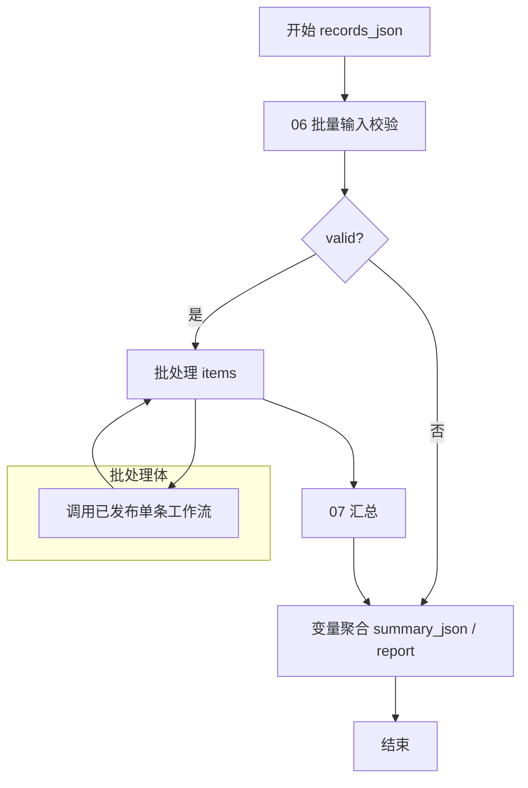

# 批量工作流：customer_qa_batch_v1

前置条件：单条工作流已在Coze完成试运行并发布。此文档是配置方案，实际配置以平台试运行记录为准。

## 节点连接

上图B与W只是表达批处理体关系，编辑器自动管理体内外连线，不要在外层画成普通循环。

## 开始与批量校验

开始输入：`records_json: String`。

P粘贴 `nodes/06_batch_prepare.py`，输入records_json绑定开始节点。输出：

| 字段 | 类型 |
|---|---|
| valid | Boolean |
| items | Array<Object> |
| summary_json | String |
| report | String |

items每个Object有 `source_index: Integer`、`ticket_id: String`、`record_json: String`。

选择器C检查P.valid。false直接输出“整批被拒绝”的报告，不能进入批处理。true进入B。

## 批处理B

输入新增 `items`，引用 `P.items`。并发数量先设为2、总次数上限设为50，避免默认次数小于输入数量而漏处理。首次用6条演示资料验证，再增加数量。并发是运行策略，不是测出的性能承诺。

在批处理体内添加“工作流”节点W，选择已经发布的 `customer_qa_single_v1`。

W输入 `record_json` 必须引用**当前批处理元素**的record_json，即当前item.record_json。不要引用整个P.items，也不要把ticket_id错绑成record_json。

B输出新增 `results`，引用W.result_json。由于W.result_json是String，B会将各轮输出聚合为 `Array<String>`。也可引用Object数组中的result_json，但要保持字段名不变；汇总代码同时支持这两种形态。

W包含的正常“待复核”结果不是技术失败，必须保留。单条里的模型、检索异常由其兜底节点转成结果。若W节点本身支持异常“返回设定内容”，可设置 `result_json=""`，避免一行失败中断整批；汇总将空值视为未匹配结果，并为缺失ID补人工复核。不能把异常默认值设为合规记录。

如果当前账号的子工作流/批处理节点仅支持中断，务必在验收记录中注明“平台级子工作流失败会中断批次”，保留失败运行记录并重跑对应输入。不要声称该情况已经自动恢复；本地漏项补齐测试不等于平台异常策略已配置成功。

## 汇总A

粘贴 `nodes/07_batch_summary.py`。

| 方向 | 字段 | 类型 | 绑定 |
|---|---|---|---|
| 输入 | items | Array<Object> | P.items |
| 输入 | results | Array<String> | B.results |
| 输出 | summary_json | String | 返回值 |
| 输出 | report | String | 返回值 |

按ticket_id关联结果，输入顺序与完成顺序不必一致。重复返回和漏项不会被当作正常成功记录；未知ID写入batch_errors。

M配置两个变量聚合组：Group1为P.summary_json和A.summary_json；Group2为P.report和A.report。注意P在成功分支也已经输出了ready摘要，因此**候选顺序必须A在前、P在后**，否则会错拿P的“ready”。更稳妥做法是在false分支增加独立“拒绝批次输出”节点，只在该分支输出P的两个文本，再参与聚合。

结束输出 `summary_json: String = M.Group1`、`report: String = M.Group2`。

## 统计口径

- total：已通过批量输入校验的输入条数。
- pass_count + violation_count + undetermined_count = total。
- review_count：需要人工复核的条数，是独立维度，不与上述三数相加。
- rule_violation_counts：每条规则命中违规的记录数，一条记录可命中多条规则，总和可超过violation_count。
- category_counts包含“未确认”，避免把未完成分析全算成“其他问题”。
- batch_status=completed只说明处理链路产生结果，不证明质检业务判断正确。

## 6条演示批次的人工预期

data/batch_demo.json：

| ID | 预期分类 | 预期质检 | 预期待复核 |
|---|---|---|---|
| DEMO-001 | 物流配送 | pass | 否 |
| DEMO-002 | 退款退货 | violation，R02 | 否 |
| DEMO-003 | 未确认 | undetermined，输入缺客服 | 是 |
| DEMO-004 | 商品质量 | violation，R01 | 否 |
| DEMO-005 | 订单与支付 | pass | 否 |
| DEMO-006 | 其他问题 | pass | 否 |

这是人工预期，不是已测结果。平台实跑后再核对：总数6、未见违规3、违规2、无法判断1、待复核1。发生模型分歧时保留真实结果与原因，不改报告数字迎合预期。
